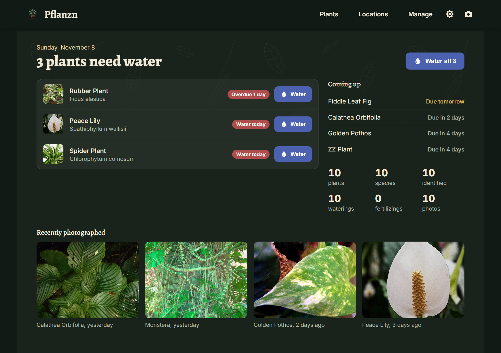
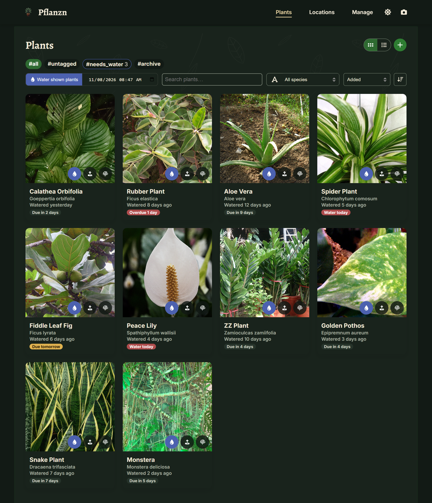
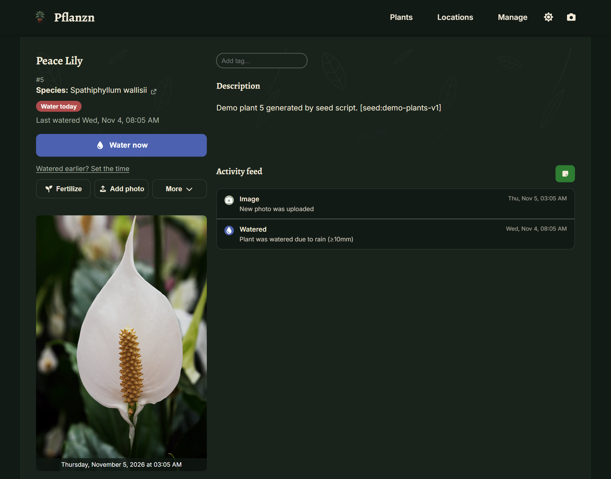
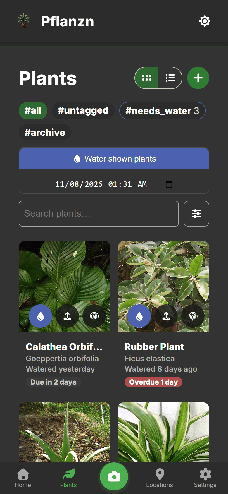
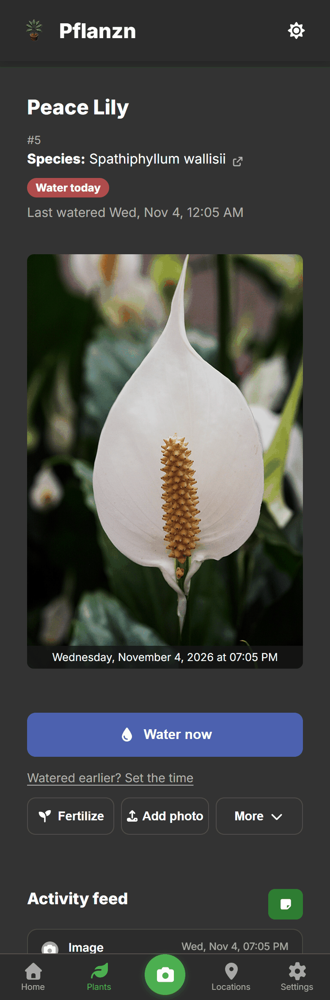
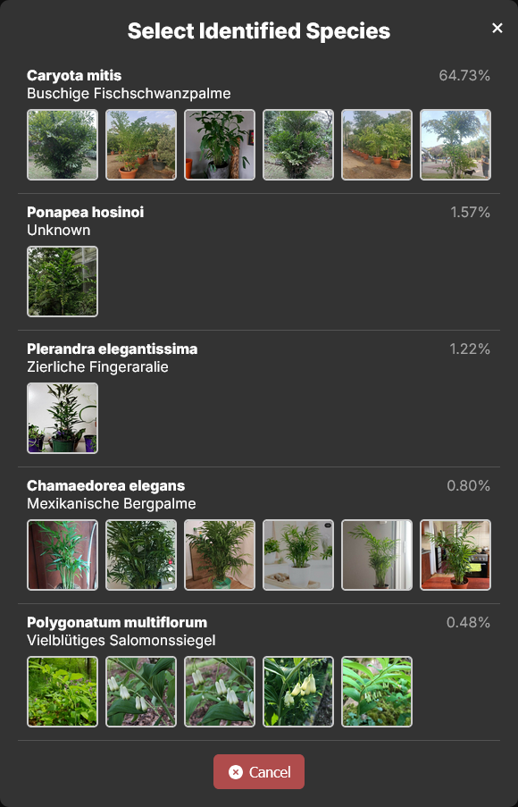
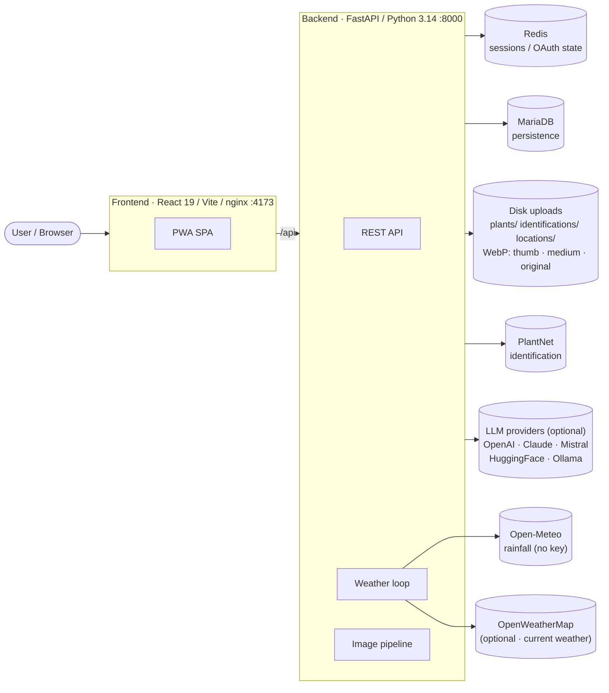

<p align="center"></p>

# Pflanzn

> Self-hostable plant management — track your collection, watering schedules, and species identification. Built as a PWA with mobile-first design and offline read access for cached data.

[](https://ko-fi.com/0x3e4)


[](https://hecate.pw/scans/targets/https%3A%2F%2Fgithub.com%2F0x3e4%2Fpflanzn)

---

<p align="center">
  
</p>

<details>
<summary><strong>More screenshots</strong> — plants list, plant page, phone, identification</summary>

<br/>

<table>
  <tr>
    <td width="50%"></td>
    <td width="50%"></td>
  </tr>
  <tr>
    <td align="center"><sub>Plants list</sub></td>
    <td align="center"><sub>Plant page</sub></td>
  </tr>
</table>

<table>
  <tr>
    <td width="33%"></td>
    <td width="33%"></td>
    <td width="33%"></td>
  </tr>
  <tr>
    <td align="center"><sub>Phone · plants</sub></td>
    <td align="center"><sub>Phone · plant page</sub></td>
    <td align="center"><sub>Species identification</sub></td>
  </tr>
</table>

</details>

---

## Table of contents

- [Documentation](#documentation)
- [Highlights](#highlights)
- [Architecture](#architecture)
- [Quick start](#quick-start)
- [Local development](#local-development)
- [Configuration](#configuration)
- [Access and visibility](#access-and-visibility)
- [MCP (Claude connector)](#mcp-claude-connector)
- [Tech stack](#tech-stack)
- [Demo](#demo)
- [Support](#support)

---

## Documentation

The full documentation (getting started, a user guide, MCP, access, configuration and
architecture) lives in [docs/](docs/) and is built into its own image,
`ghcr.io/0x3e4/pflanzn-docs`. Run it next to the app and it is served at **`{DOMAIN}/docs/`**,
and on a domain of its own if you route one to it; both work at once. See
[Documentation site](docs/getting-started.md#documentation-site).

---

## Highlights

|     |     |
| --- | --- |
| **Catalogue** | Plants with photos, species info, care notes; tags and locations with GPS coordinates and an interactive Leaflet map. Locations have their own tags, notes and harvest times. |
| **Tracking** | Watering, fertilizing, image, and care-advice timelines with calendar view and per-activity colour coding. |
| **Watering schedule** | Optional "water every N days" per plant. Due plants get a badge and show up under the automatic `#needs_water` filter, which combines with any tag (e.g. `#office` + `#needs_water`) — then *Water Plants* waters exactly those. |
| **Mobile list view** | Plants and Locations switch between a photo grid and a compact list with one-tap water/upload buttons; the choice is remembered per device. |
| **Statistics** | Watering status of the whole collection, a year of care as a calendar, waterings per week by hand and by rain, plants per tag and species, the most cared-for and the longest-unwatered plants. |
| **Archive** | Plants can be archived with a reason instead of deleted — they drop out of the normal lists and stay reachable under the `#archive` filter, and can be restored at any time. |
| **Identification** | One-shot PlantNet integration — accepts JPG / PNG / WebP / HEIC; the backend normalises uploads to JPEG before forwarding. |
| **AI care advice** | Care advice and species descriptions; a generated description also fills in the watering interval when none is set. Optional integration with OpenAI, Claude, Mistral, HuggingFace, or a local Ollama instance — provider auto-detected from whichever API key is set. |
| **Floor plans** | Upload a plan of your home, place plants on it and see at a glance which ones need water. Pinch-zoom and tap-to-place on mobile; members only. Enabled by an admin under Manage → Floor plans. |
| **MCP** | Optional [MCP](https://modelcontextprotocol.io) endpoint for Claude and other AI clients, secured with OAuth. |
| **Auto-watering** | Outdoor plants with `reaches_rain=true` are auto-watered when Open-Meteo reports rainfall above your threshold. Optional OpenWeatherMap key for current-weather display. |
| **PWA** | Installable on phone or desktop; Workbox runtime caching — CacheFirst for uploaded images, NetworkFirst for plants, locations, profile, and statistics reads (the cache is only used when the network fails, so changes show at once). |
| **Sharing** | Token-based public collection links with a dedicated read-only view. |
| **Auth modes** | `no` (open), `local` (JWT + Argon2 + Redis sessions with theft detection), or `oidc` (external IdP). |
| **Audit log** | Every write action and authentication event is recorded to an immutable log, viewable by admins under Manage → Audit with filters for action, entity, user, date, and free-text search. |
| **No telemetry** | No tracking. No ads. |

---

## Architecture



---

## Quick start

> [!NOTE]
> Requires Docker + Docker Compose. The compose file is gitignored — copy from the `.example` first.

```bash
cp .env.example .env
cp docker-compose.yml.example docker-compose.yml
# Edit .env with your settings (database, API keys, domain, etc.)
docker compose up -d --build
```

The app will be reachable at the domain you configured in `DOMAIN`. See [.env.example](.env.example) for all available settings.

### Reverse proxy

The frontend container is the gateway: it serves the app and forwards `/api`, `/mcp` and
`/.well-known/oauth-*` to the backend and `/docs/` to the docs container. Your reverse proxy only
needs the frontend, and backend and docs need no published port and no place on the proxy's
network.

Caddy:

```caddyfile
plants.example.com {
    reverse_proxy localhost:4173
}
```

nginx:

```nginx
location / {
    proxy_pass http://localhost:4173;
    proxy_set_header Host $host;
    proxy_set_header X-Forwarded-For $proxy_add_x_forwarded_for;
    proxy_set_header X-Forwarded-Proto $scheme;
    client_max_body_size 30m;   # match MAX_UPLOAD_MB
    proxy_read_timeout 300s;    # AI care advice with web search can take minutes
}
```

How the frontend finds the others, and whose client IP it believes, is set on the frontend
container:

| Variable | Default | What it controls |
| --- | --- | --- |
| `BACKEND_UPSTREAM` | `http://pflanzn-backend:8000` | The backend. The compose example gives it this alias. |
| `DOCS_UPSTREAM` | `http://pflanzn-docs:80` | The docs container. Without one, `/docs` redirects to the docs on GitHub. |
| `TRUSTED_PROXIES` | private networks | Addresses or CIDRs (comma-separated) whose `X-Forwarded-For` is believed, for the client IP in the audit log and the rate limits. Set it to your proxy's address; `none` turns it off. |
| `MAX_UPLOAD_MB` | `30` | The largest upload the frontend passes on; keep it equal to the backend's. |
| `UPSTREAM_RESOLVER` | `127.0.0.11` | The DNS server for those names (Docker's own). Change it outside Docker. |

> [!IMPORTANT]
> On a Docker network shared with other apps, use names only Pflanzn has, like the
> `pflanzn-backend` and `pflanzn-docs` aliases in the compose example. A bare `backend` can resolve
> to another app's container.

The old layout still works: a proxy that sends `/api`, `/mcp` and `/.well-known/oauth-*` straight to
the backend's port 8000 (and everything else to the frontend) needs no change.

Prebuilt images are published to GHCR on every push to `main` and on every semver tag (`X.Y.Z`) by [build-images.yml](.github/workflows/build-images.yml):

- `ghcr.io/0x3e4/pflanzn-backend`
- `ghcr.io/0x3e4/pflanzn-frontend` (multi-stage build → nginx alpine; the gateway: forwards `/api`, `/mcp` and `/.well-known/oauth-*` to the backend and `/docs/` to the docs container)
- `ghcr.io/0x3e4/pflanzn-docs` (MkDocs Material → nginx alpine, optional)

`main` builds get the `latest` and `main-<sha>` tags; release builds get `X.Y.Z`, `X.Y`, and `X` tags. For production, pin to an explicit semver tag — see [SECURITY.md](SECURITY.md) for the supported-version policy.

---

## Local development

### Frontend

```bash
cd frontend
pnpm install
pnpm run dev          # Vite dev server with hot reload
pnpm run build        # TypeScript check + production build
pnpm run lint         # ESLint
pnpm test             # Vitest
pnpm run test:watch   # Vitest in watch mode
```

Requires Node ≥ 24.

### Backend

The backend runs in Docker with `--reload`. For manual setup:

```bash
cd backend
poetry install
uvicorn app.main:app --host 0.0.0.0 --port 8000 --reload
```

Tests:

```bash
cd backend
poetry run pytest tests/ -v
```

### Documentation

```bash
poetry -P docs install
poetry -P docs run mkdocs serve      # http://127.0.0.1:8000, reloads on change
```

Requires Python 3.14. The image build runs `mkdocs build --strict`, so a broken link fails it.

### Linting

Pre-commit hooks (husky + lint-staged) run ESLint and Prettier on staged frontend files. The backend uses ruff:

```bash
poetry run ruff check backend/app/ --fix
```

---

## Configuration

Everything is driven through environment variables — see [.env.example](.env.example) for the full list. Frontend runtime configuration is fetched from `GET /api/config` so prebuilt images can be reconfigured per deployment without rebuilding.

| Category | Key variables |
| --- | --- |
| **General** | `SECRET_KEY`, `TZ`, `LOCALE`, `DOMAIN` |
| **Auth** | `AUTH_MODE` (`no` / `local` / `oidc`), `SHOW_PROTECTED_VIEW`, `ADMIN_USER`, `ADMIN_EMAIL`, `ADMIN_PASSWORD` |
| **OIDC** | `OIDC_NAME`, `OIDC_PROVIDER_URL`, `OIDC_CLIENT_ID`, `OIDC_CLIENT_SECRET`, `OIDC_REQUIRE_VERIFIED_EMAIL` (default `true`) |
| **Database** | `DB_HOST`, `DB_PORT`, `DB_USER`, `DB_PASSWORD`, `DB_ROOT_PASSWORD`, `DB_NAME` |
| **Redis** | `REDIS_URL` |
| **Features** | `ENABLE_LOCATIONS`, `AUDIT_ENABLED`, `ENABLE_API_DOCS` (default `false`), `MAX_UPLOAD_MB` (default `30`) |
| **AI** | `AI_ENABLED`, `LLM_ENABLED`, `CARE_WEB_SEARCH` (Claude and OpenAI, default `true`), `MCP_ENABLED`, `MCP_OAUTH_ISSUER`, `MCP_OAUTH_AUDIENCE`, `MCP_LOGIN_*` |
| **Identification** | `PLANTNET_API_KEY`, `PLANTNET_LANGUAGE` |
| **AI providers (optional)** | `LLM_LANGUAGE`, `OPENAI_API_KEY` / `OPENAI_MODEL_NAME`, `CLAUDE_API_KEY` / `CLAUDE_MODEL_NAME` / `CLAUDE_EFFORT` (`low` to `max`, empty = the model's default), `MISTRALAI_API_KEY` / `MISTRALAI_API_URL` / `MISTRALAI_MODEL_NAME`, `HUGGINGFACE_API_KEY` / `HUGGINGFACE_MODEL_NAME`, `OLLAMA_URL` / `OLLAMA_MODEL_NAME`. Provider auto-detected from whichever key is set; priority `openai > claude > mistralai > huggingface > ollama`. |
| **Weather** | `WEATHER_ENABLED`, `WEATHER_CHECK_INTERVAL_HOURS`, `WEATHER_RAINFALL_THRESHOLD_MM`, `OPENWEATHERMAP_API_KEY` (optional) |

> [!NOTE]
> Legacy `VITE_*` names (`VITE_DOMAIN`, `VITE_AUTH_MODE`, …) still resolve as fallbacks in the backend, but they're misleading — these vars are read by the **backend** at runtime and exposed to the frontend via `/api/config`. Vite itself never sees them, so the prefix carries no meaning. New deployments should use the unprefixed names.

---

## Access and visibility

Who can read the collection depends on `AUTH_MODE` and `SHOW_PROTECTED_VIEW`:

| Reader | `AUTH_MODE=no` | `local` / `oidc`, `SHOW_PROTECTED_VIEW=true` (default) | `local` / `oidc`, `SHOW_PROTECTED_VIEW=false` |
| --- | --- | --- | --- |
| Logged-in user | — | Read and edit everything | Read and edit everything |
| Share-link viewer | — (sharing needs auth) | Read-only | Read-only (existing links work; new ones can't be created in this mode) |
| Anonymous visitor | Read and edit everything | Login screen, no data | Read-only |

Plants, tags, notes, care advice and statistics have no visibility of their own:
whoever may read the collection sees all of them. Photos follow the same rules.
Read-only visitors don't see editing controls; each page shows a "Sign in to …" line instead.

**Locations** carry a visibility status, set in the *Visibility* field of a location's
detail page:

| Status | Visible to |
| --- | --- |
| `private` (default) | Logged-in users only |
| `shared` | Logged-in users and share-link viewers |
| `public` | Everyone who may read the collection — including anonymous visitors when `SHOW_PROTECTED_VIEW=false` |

A location's photos, tags, notes and harvest times are hidden along with it. With `AUTH_MODE=no` there are no logins,
so every location is visible to everyone regardless of its status.

> [!NOTE]
> Until 1.0.6 the status was only a label and was not enforced, so every location was
> visible to share-link viewers. Locations created through the app were always
> `private`, which means they disappear from share links after upgrading until you set
> them to `shared` or `public`.

The installed PWA keeps viewed photos in its offline cache for up to 30 days, so a
location made private later may still show on a device that already loaded it.

---

## MCP (Claude connector)

Pflanzn has a built-in [MCP](https://modelcontextprotocol.io) server, so Claude or any other MCP
client can read your plants and, if you allow it, log waterings, add notes and care advice, and
create or edit plants. Nothing can be deleted through it.

Set `MCP_ENABLED=true` and add `{DOMAIN}/mcp` as a custom connector in Claude (Claude Code:
`claude mcp add --transport http pflanzn {DOMAIN}/mcp`; `/api/mcp` still works). Clients sign in through Pflanzn's
built-in OAuth server with your normal login, through another provider (`MCP_LOGIN_PROVIDER`), or
through an external OAuth/OIDC server (`MCP_OAUTH_ISSUER`). The frontend forwards `/mcp` and
`/.well-known/oauth-*` to the backend (see [Reverse proxy](#reverse-proxy)). Connected apps can be revoked under Manage → MCP.

**[MCP guide](docs/mcp.md)**: the sign-in modes, connecting each client, all 15 tools and example
prompts.

---

## Tech stack

| Component | Technology |
| --- | --- |
| Backend | Python 3.14, FastAPI, SQLAlchemy ORM, Uvicorn, Poetry |
| Database | MariaDB |
| Cache | Redis (sessions, OAuth state) |
| Frontend | React 19, TypeScript 6, Vite 8, React Router v7, pnpm |
| Production serving | nginx alpine (multi-stage Dockerfile, served on port 4173) |
| Auth | JWT (HS256), Argon2, OIDC (authlib), Redis-backed sessions with IP + User-Agent theft detection |
| Identification | PlantNet (HEIC / WebP / PNG / JPG accepted; normalised to JPEG before forwarding) |
| AI care helper | OpenAI · Claude · Mistral · HuggingFace · Ollama (factory-pattern, each optional) |
| Weather | Open-Meteo (rainfall, no key); OpenWeatherMap (optional, current weather display) |
| PWA | vite-plugin-pwa + Workbox (CacheFirst for images / NetworkFirst for API reads) |
| Image pipeline | Pillow + pillow_heif → 3 WebP variants per upload (`thumb` 300px, `medium` 800px, `original` 2000px) served via `?size=…` |
| Docs | MkDocs Material, own image, served at `/docs/` and on its own domain |
| Deployment | Docker Compose; GHCR images via [GitHub Actions](.github/workflows/build-images.yml) |

---

## Demo

A public demo is available at **[pflanzn.app](https://pflanzn.app)** — login with `admin` / `admin`. Data resets every 4 hours.

---

## Support

Pflanzn is built and maintained as a labour of love. If it makes your plant-care routine easier, a small tip keeps the lights on:

<a href="https://ko-fi.com/0x3e4" target="_blank"></a>

A star on the [GitHub repo](https://github.com/0x3e4/pflanzn) is just as welcome — bug reports and pull requests too.

Pflanzn is developed with the help of an AI coding assistant ([Claude Code](https://claude.com/claude-code)).

<br>

<div align="center">
Made with ❤ in Austria
</div>
