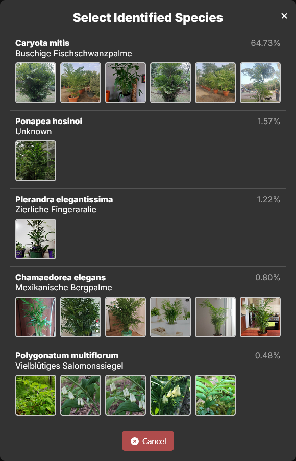

# Identification & AI

Both features are optional. Identification needs a Pl@ntNet API key, the AI features need a key for
one AI provider (or a local Ollama), and `AI_ENABLED=false` turns all of them off at once.

## Species identification

Take or pick a photo and Pl@ntNet suggests the species. Start from the camera button in the
navigation, from the fingerprint button on a plant card, or with *Identify species* in a plant's
*More* menu. JPG, PNG, WebP and HEIC are accepted; the backend converts every upload to JPEG before
sending it to Pl@ntNet.

The result lists the likely species with their scores. Picking one sets the plant's species; started
from the camera button, it opens a new plant with that species filled in. Past identifications are
kept under Manage → Identifications.

Once a plant has a species, its page links to the species on Pl@ntNet, in the language set by
`PLANTNET_LANGUAGE`.

{ width="320" }

## Species descriptions

With no description yet, a plant offers two ways to get one:

- **Reuse** the description of another plant of the same species, if one has it.
- **Generate** one with AI (*More → Write description with AI*). The AI writes a short botanical
  description covering habitat, appearance, care and one interesting fact, in `LLM_LANGUAGE`.

A generated description also suggests the **watering interval**. If the plant has none yet,
Pflanzn sets it right away, so the plant joins the watering schedule. An interval you set yourself
is never changed; the message then just names the suggestion.

## Care advice

*More → Ask AI for care advice* asks the AI to look at the plant: its species, recent watering,
fertilizing and notes, Pl@ntNet facts and its latest photos. You can add a question of your own, like "the lower
leaves turn yellow". With Claude and OpenAI the AI may also search the web for current advice
(`CARE_WEB_SEARCH`, on by default, costs extra per request).

The advice is saved to the plant. The newest one is shown on the plant page under *Care advice*,
and the earlier ones are one click away under *Earlier advice*.

An assistant connected over [MCP](../mcp.md) can also write care advice with its own reasoning and
save it to the same history. That works without any AI key on the server.

## Providers

| Provider | Keys |
| --- | --- |
| OpenAI | `OPENAI_API_KEY`, `OPENAI_MODEL_NAME` |
| Claude | `CLAUDE_API_KEY`, `CLAUDE_MODEL_NAME`, `CLAUDE_EFFORT` (`low` to `max`, empty for the model's default) |
| Mistral | `MISTRALAI_API_KEY`, `MISTRALAI_API_URL`, `MISTRALAI_MODEL_NAME` |
| Hugging Face | `HUGGINGFACE_API_KEY`, `HUGGINGFACE_MODEL_NAME` |
| Ollama (local) | `OLLAMA_URL`, `OLLAMA_MODEL_NAME` |

Pflanzn uses the provider whose key is set. With several keys set, the order is
openai, claude, mistralai, huggingface, ollama. `LLM_ENABLED=false` turns off the AI texts but
keeps identification and MCP.
