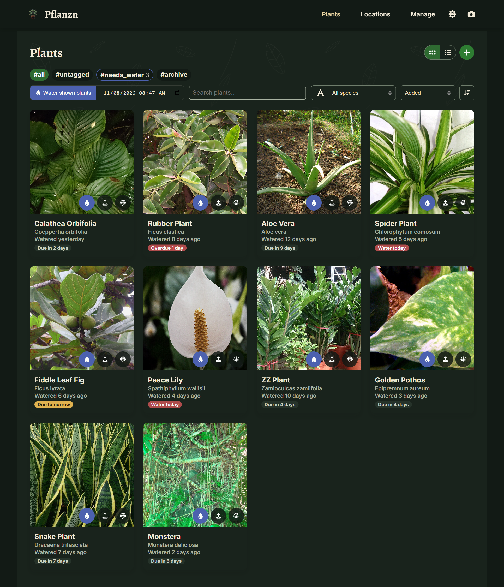
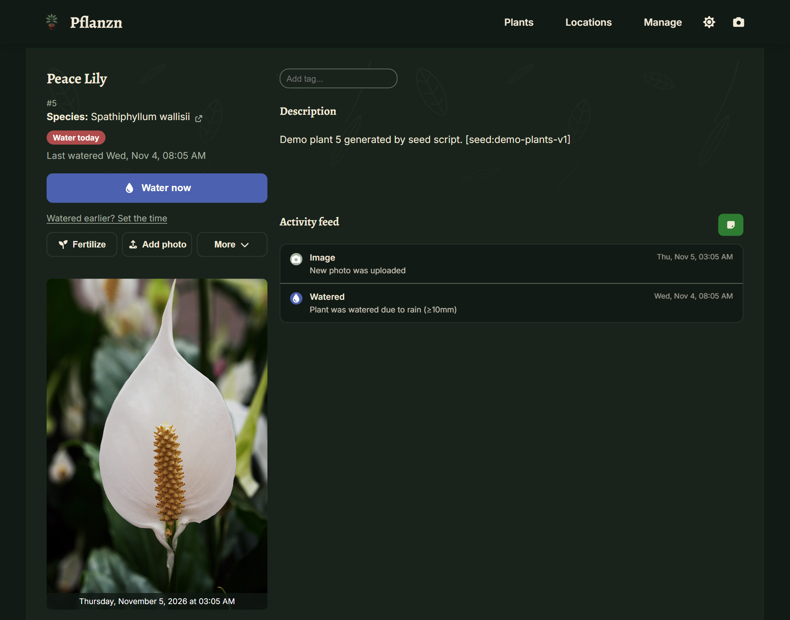
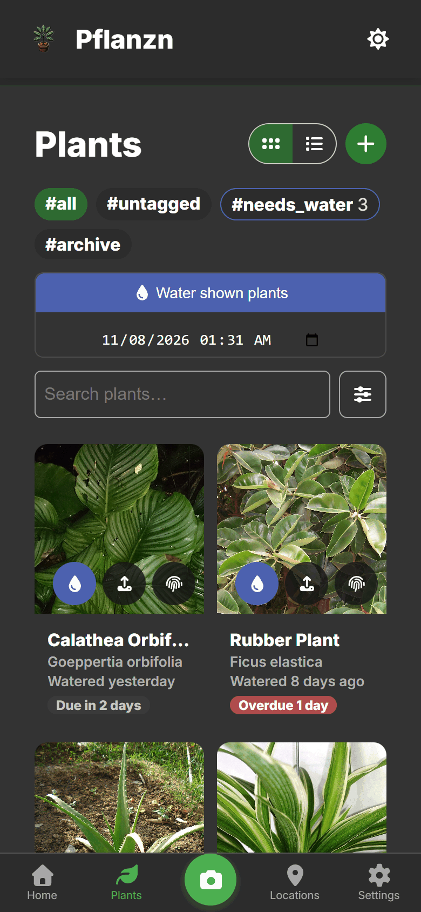

# Plants & Watering

Plants are the heart of Pflanzn. Each one has a name, an optional species, photos, tags, a
description and a timeline of everything that happened to it.

## The home page

The home page answers one question: **what needs water today?** It lists every plant whose
schedule is due, each with its own *Water* button, and *Water all* waters the whole list in one go.
Next to it, *Coming up* shows the plants due next. Below are the collection figures and the most
recently photographed plants.

## Watering schedule

Give a plant a watering interval ("water every N days") and Pflanzn works out when it is due from
the last watering. The badge on the plant tells you where it stands:

| Badge | Meaning |
| --- | --- |
| Overdue | The due date has passed. |
| Water today | Due today. |
| Due tomorrow | Due tomorrow. |
| Due in N days | Not due yet. |

Due plants also appear under the automatic **`#needs_water`** filter on the plants list. It combines
with any tag, so `#office` + `#needs_water` shows the office plants that are due, and
*Water shown plants* waters exactly those, at the time you pick.

Plants without an interval never count as due. When you generate a plant's description with AI, it
also fills in a watering interval, as long as the plant doesn't have one yet (see
[Identification & AI](ai.md#species-descriptions)).

## Logging care

On a plant's page:

- **Water now** logs a watering for this moment. *Watered earlier? Set the time* logs one in the past.
- **Fertilize** logs fertilizing.
- **Add photo** adds a photo to the plant's photo timeline. JPG, PNG, WebP and HEIC are accepted;
  every upload is stored in three sizes.
- **More** holds the rest: identification, AI care advice and description, archiving, deleting.

On the plants list, each card has the same quick buttons for watering, adding a photo and
identifying.

## Timeline, calendar and notes

The **activity feed** on the plant page lists waterings, fertilizing, photos and notes, newest
first. It shows the latest six and loads older ones on demand. The note button above it adds a
note, for observations, repotting, pests or anything else.

AI care advice has its own block above the feed: the newest is open, the earlier ones are under
*Earlier advice*. The **calendar** shows all of it by day, each kind of activity in its own colour.

## Tags, views and search

Tags group plants however you like, by room, by light or by owner. The plants list filters by tag,
searches by name and species, and sorts. It switches between a photo grid and a compact list, and
the choice is remembered per device.

## Archive

A plant that died or was given away can be **archived** with a reason instead of deleted. It drops
out of the normal lists and the watering schedule but keeps its whole history. It stays reachable
under the `#archive` filter and can be restored at any time.

## Rain counts as watering

Outdoor plants marked *reaches rain* are watered automatically when Open-Meteo reports more rain
than your threshold (`WEATHER_RAINFALL_THRESHOLD_MM`). The watering shows up in the feed as
"watered due to rain". This needs `WEATHER_ENABLED=true` and a weather zone: create one with its
coordinates under Manage → Weather, then pick it in the plant's *Weather zone* field. See
[Configuration](../configuration.md#weather).

## On your phone

Pflanzn is a PWA: install it from the browser to get an app icon and a full-screen window. On a phone
the navigation moves to a bottom bar with the camera in the middle, and a plant's actions sit right
under its photo. Plants, locations and photos you have already opened stay readable without a
connection.

{ width="320" }
