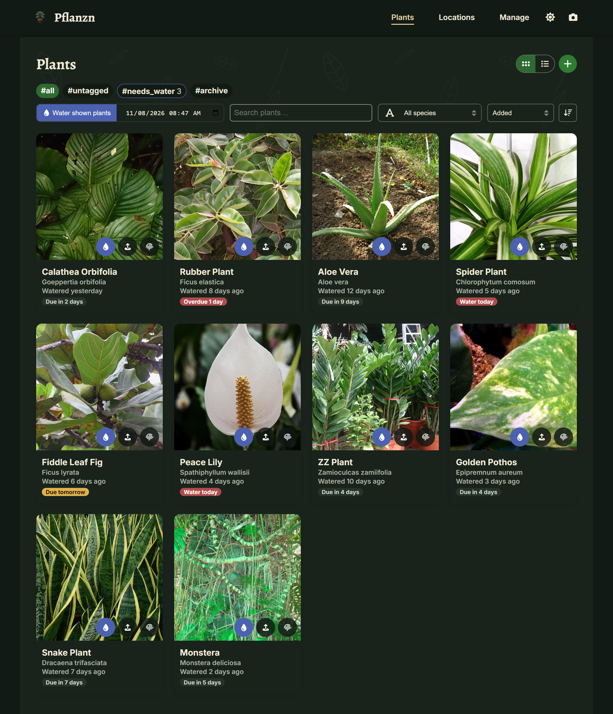
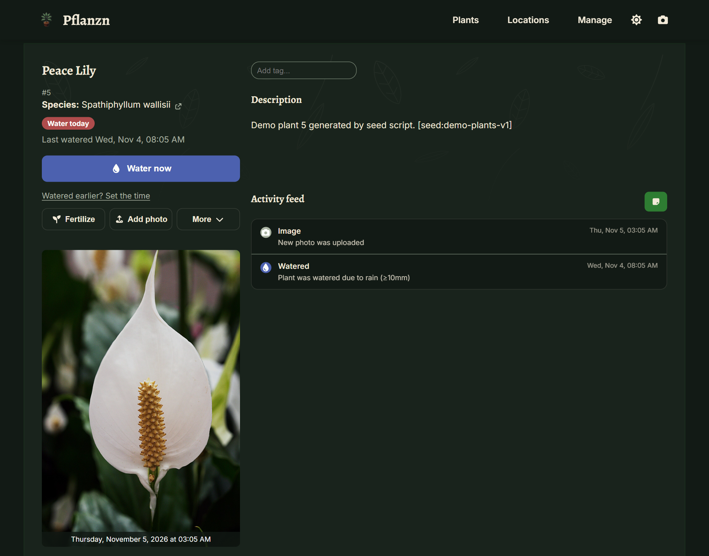
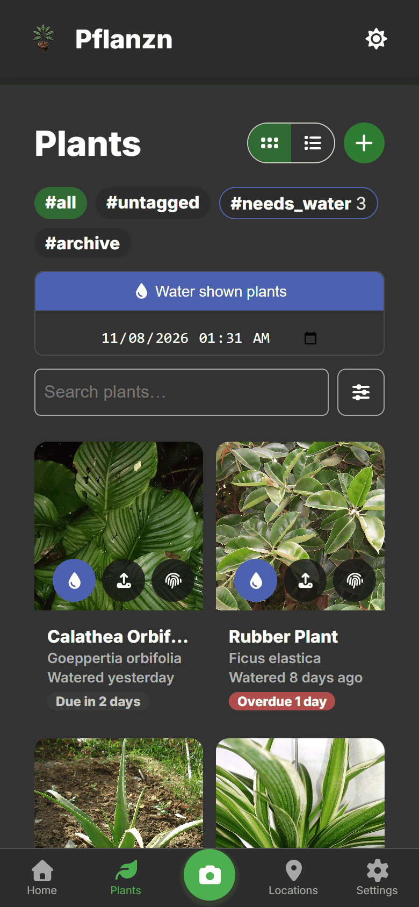

# Plants & Watering

Plants are the heart of Pflanzn. Each one has a name, an optional species, photos, tags, a
description and a timeline of everything that happened to it.

## The home page

The home page answers one question: **what needs water today?** It lists every plant whose
schedule is due, each with its own *Water* button, and *Water all* waters the whole list in one go.
Next to it, *Coming up* shows the plants due next. Below are the collection figures and the most
recently photographed plants, and then three blocks:

- **Lately**: what happened in the last two weeks across all plants. A "Water all" or a rainy day is
  one line; members also see who did it.
- **Care rhythm**: the last twelve weeks, one square per day, darker the more care it got. Point
  at a day, or tap it on a phone, to see what happened; the arrow keys move from day to day.
- **Your areas**: your tags as tiles, with how many plants each has and how many need water.

Next to *Coming up*, **Reminders** lists the reminders of the next two weeks (see
[Timeline, calendar and notes](#timeline-calendar-and-notes)), each with its plant and time.

## Watering schedule

Give a plant a watering interval ("water every N days") and Pflanzn works out when it is due from
the last watering. The badge on the plant tells you where it stands:

| Badge | Meaning |
| --- | --- |
| Overdue | The due date has passed. |
| Water today | Due today. |
| Due tomorrow | Due tomorrow. |
| Due in N days | Not due yet. |

Due plants also appear under the automatic **`#needs_water`** filter on the plants list. It combines
with any tag, so `#office` + `#needs_water` shows the office plants that are due, and
*Water shown plants* waters exactly those, at the time you pick.

Plants without an interval never count as due. When you generate a plant's description with AI, it
also fills in a watering interval, as long as the plant doesn't have one yet (see
[Identification & AI](ai.md#species-descriptions)).

## Logging care

On a plant's page:

- **Water now** logs a watering for this moment. *Watered earlier? Set the time* logs one in the past.
- The **watering schedule** field ("Water every N days") sets or clears the interval.
- **Environment**: *Outdoor plant*, *Reaches rain* and the *Weather zone* decide whether
  [rain counts as watering](#rain-counts-as-watering).
- **Fertilize** logs fertilizing.
- **Add photo** adds a photo to the plant's photo timeline. JPG, PNG, WebP and HEIC are accepted;
  every upload is stored in three sizes.
- **More** holds the rest: identification, AI care advice and description, archiving, deleting.

On the plants list, each card has the same quick buttons for watering, adding a photo and
identifying.

You can also **drag photos** from your computer onto the plants list. A dashed frame shows where
they go: drop them on a plant's card (or row) and they are added to that plant; drop them anywhere
else and *Add Plant* opens with them, ready to identify. All photos dropped at once go to the new
plant.

## Timeline, calendar and notes

The **activity feed** on the plant page lists waterings, fertilizing, photos, notes and care
advice, newest first. It shows the latest six and loads older ones on demand. Waterings tend to
crowd out the rest, so the chips above the feed narrow it down: pick *Notes* to see only notes,
then add more kinds, or *All* to see everything again. Plants outside that get rain have a separate
*Rain* chip, so the rain waterings can be hidden while your own stay. The browser remembers your
choice.

The note button above the feed adds a note, for observations, repotting, pests or anything else.
Give it a **Remind me** date and time and the note is also a **reminder**: it shows under
*Reminders* above the feed and as a dashed day in the calendar, and if
[notifications](../notifications.md) are set up, it is sent when it is due. Click today or a later
day in the calendar and choose *Add reminder* to start one for that day. An assistant connected
over [MCP](../mcp.md) can set reminders too.

AI care advice has its own block above the feed: the newest is open, the earlier ones are under
*Earlier advice*; the feed lists them too, folded. The **calendar** shows all of it by day, each
kind of activity in its own colour. Click a day to see what happened then, with the time of each
entry; members can delete a wrong entry there (a watering logged twice, a photo on the wrong plant).

## Tags, views and search

Tags group plants however you like, by room, by light or by owner. Add and remove them at the top
of a plant's page; Manage → Tags renames and deletes them.

The plants list:

- **Filters** by tag (the chips at the top, `#needs_water` and `#archive` included) and **searches**
  by name, or by species after a click on the switch next to the search box.
- **Sorts** by last watered, next watering, latest photo or id, either way round.
- **Shows** a photo grid, a compact list or, with [floor plans](locations.md#floor-plans) on, the
  plan. The expand button widens the page on a large screen (Manage → Customize makes that the
  default).
- **Water shown plants** waters every plant the current filter shows, at a time you pick.

View, filter and sort are remembered per device.

## Archive

A plant that died or was given away can be **archived** with a reason instead of deleted. It drops
out of the normal lists and the watering schedule but keeps its whole history. It stays reachable
under the `#archive` filter and can be restored at any time.

## Rain counts as watering

Outdoor plants marked *reaches rain* are watered automatically when Open-Meteo reports more rain
than your threshold (`WEATHER_RAINFALL_THRESHOLD_MM`). The watering shows up in the feed as
"watered due to rain". This needs `WEATHER_ENABLED=true` and a weather zone: create one with its
coordinates under Manage → Weather, then pick it in the plant's *Weather zone* field. See
[Configuration](../configuration.md#weather).

## Statistics

Manage → Statistics shows the collection at a glance:

- **Totals** for plants, waterings, fertilizing, photos and identifications. Waterings,
  fertilizing and photos also show the last 30 days against the 30 before.
- **Watering right now**: how many plants are overdue, due today, due tomorrow, fine for now, or
  have no schedule. *Overdue* and *Due today* open the plants list filtered to them.
- **Care over the past year**: one square per day, darker (in the light theme) the more was
  watered, fertilized or photographed. Hover a day for the details.
- **Waterings per week** for the last twelve weeks, split into waterings by hand and by rain.
- **Plants per tag** and **top species**, each opening the filtered plants list.
- **Most cared for** in the last 90 days, counting only what someone did by hand, and the plants
  **longest without water**.

The calendar and the weekly chart have a *Show as table* view with the same numbers; the other
charts print their numbers next to the bars.

## On your phone

Pflanzn is a PWA: install it from the browser to get an app icon and a full-screen window. On a phone
the navigation moves to a bottom bar with the camera in the middle, and a plant's actions sit right
under its photo. Plants, locations and photos you have already opened stay readable without a
connection.

{ width="320" }
