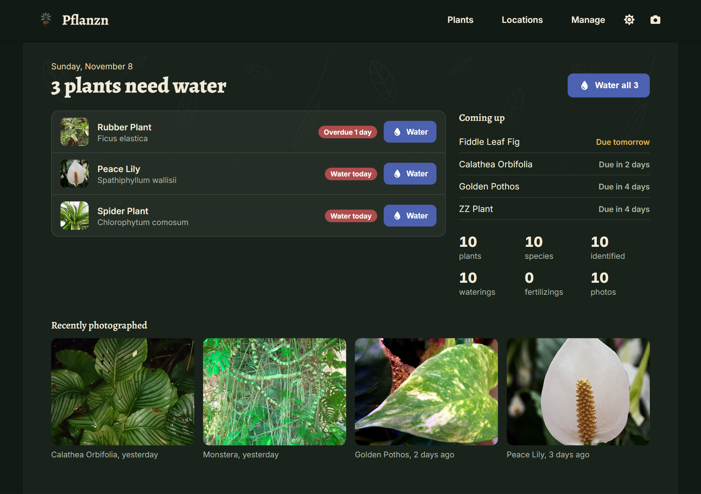

# Pflanzn

Pflanzn is a self-hostable **plant management** app. It keeps track of your collection, tells you
which plants need water today, and logs every watering, fertilizing, photo and note on a timeline.
Species identification goes through Pl@ntNet, and care advice and descriptions can come from the AI
provider of your choice. It is a PWA: installable on phone and desktop, built mobile-first, and the
data it has already loaded stays readable offline.

## What it does

-   :material-sprout: **Plants & watering**

    Photos, species, tags and notes per plant. A "water every N days" schedule puts due plants on the
    home page and under `#needs_water`. → [Plants & Watering](guide/plants.md)

-   :material-map-marker-radius: **Locations & floor plans**

    Garden spots with GPS coordinates on a map, and a plan of your home with your plants on it.
    → [Locations & Floor Plans](guide/locations.md)

-   :material-leaf-circle: **Identification & AI**

    Identify a species from a photo, and let an AI write care advice and descriptions.
    → [Identification & AI](guide/ai.md)

-   :material-robot-outline: **MCP server**

    Ask Claude or another assistant which plants need water, and let it log the watering.
    → [MCP Server](mcp.md)

-   :material-shield-account: **Access & sharing**

    Open, local accounts or your identity provider, read-only share links and an audit log.
    → [Access & Visibility](access.md)

-   :material-cog-outline: **Configuration**

    Everything runs from environment variables, so the prebuilt images work in every setup.
    → [Configuration](configuration.md)

## Try it

A public demo runs at **[pflanzn.app](https://pflanzn.app)**. Sign in with `admin` / `admin`; the
data resets every four hours. To run your own, start with [Getting Started](getting-started.md).

## Principles

- **Self-hosted.** Your plants, photos and history stay on your server.
- **No telemetry.** No tracking, no ads.
- **Optional extras.** Identification, AI, weather and MCP each switch on with a key or a flag, and
  the app works fully without them.

The source is on [GitHub](https://github.com/0x3e4/pflanzn). Bug reports and pull requests are
welcome.
